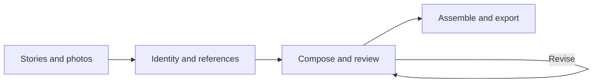

# Autonomous Atelier

Autonomous Atelier turns stories and photographs into designed magazine spreads and complete issues. It combines AI art direction with a local layout and rendering engine, keeping each design editable and connected to its original copy and images.

The studio is built around the relationship between photography and typography: large display words, text over images, subjects appearing in front of type, image-filled lettering, and compositions that continue across facing pages. A reusable reference library gives the system concrete design relationships to work with.

## What it can do

| Capability | What it provides |
| --- | --- |
| Story and photo preparation | Import titles, introductions, body copy and credited photographs; inspect image quality, faces, important subjects and useful space. |
| Editorial identity | Define fonts, colours, spacing, reading sizes and visual direction for a consistent publication. |
| Reference-based composition | Adapt captured designs to new stories while retaining their typography, layering, image relationships and reading areas. |
| Creative exploration | Generate and compare alternative concepts and layouts, with bounded repair attempts and recorded model feedback. |
| Expressive page design | Use cutouts, masks, gradients, outlined or rotated type, text along paths, irregular text flow and image-filled letterforms. Available rendering techniques extend beyond the reference fitter's supported layouts. |
| Issue assembly | Arrange six stories into a twelve-page magazine, handle front and back covers, choose a varied sequence of admitted designs, and preserve selected scenes during assembly. |
| Review and revision | Inspect full spreads and full-resolution detail crops, check source coverage and readability, edit scenes, restore earlier versions and revise individual issue spreads. |
| Export and traceability | Export PDF proofs and editable scenes; run separate production checks; inspect provider requests, visible responses, usage, estimated costs and recovery history. |

## From material to magazine



The reference workflow fits exact story text into measured designs, then checks the rendered result. A design that cannot hold the copy or preserve required image relationships is rejected. AI selection and visual feedback help choose among candidates; editorial approval remains a human decision.

## Explore the studio

The application has four work areas:

- **Inputs:** add material, choose a design direction and queue composition work.
- **Spread Studio:** inspect references, candidates, complete issues and editable scenes.
- **Logs & Telemetry:** follow jobs, model requests, usage, estimated costs and recoveries.
- **Export:** download proofs and scenes, or request a production check.

## Run locally

Follow [Setup and run](setupandrun.md) for first-time installation, required assets, daily startup and troubleshooting.

The development environment uses Conda environment `clinic`. A new machine also needs the native rendering libraries and local assets described in the [technical architecture](architecture_technical.md#local-environment). Generated projects, photographs, model weights and exports are kept outside Git, so cloning the source does not restore an existing studio library.

Create `.env` from [.env.example](.env.example) if needed, then set `OPENAI_API_KEY` or `OPENAI_KEY`. Model and runtime settings live in [config.yaml](config.yaml).

From the repository root:

```bash
conda activate clinic
python -m editorial_studio.worker --initialize
python -m streamlit run app.py --server.address 127.0.0.1 --server.port 8501
```

Run the worker in a second terminal so queued jobs can execute:

```bash
conda activate clinic
python -m editorial_studio.worker
```

Composition and model-review jobs can send selected copy and images to the configured provider and incur charges. Browsing saved results and downloading exports do not start model calls.

## Understand the design

- [Domain architecture](architecture_domain.md): the editorial ideas and workflow, explained in everyday language.
- [Technical architecture](architecture_technical.md): processes, modules, data storage, rendering and recovery.

The source includes automated tests, pinned dependency metadata and verification scripts. Run the test suite with `python -m pytest -q` from the prepared environment.

The reference library is curated; automatic reference ingestion and automatic skill generation are disabled. Visual proofs and model reviews support an editor's judgment. Production exports require their own checks and are RGB proofs, without PDF/X or printer-specific certification.

## License

[MIT](LICENSE).
