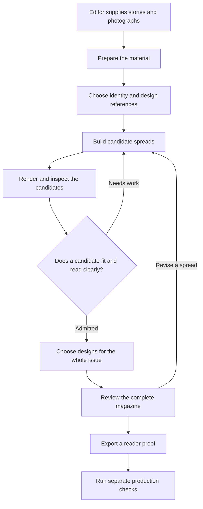
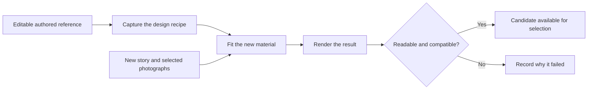

# Domain architecture

This guide explains the editorial side of Autonomous Atelier. For the software that carries it out, see the [technical architecture](architecture_technical.md).

Imagine making a small magazine about space. You have six stories and several photographs. You must choose which pictures work, decide how the pages should look, make the words readable, and arrange the stories into a satisfying sequence. Autonomous Atelier brings those jobs into one studio.

## The things the studio works with

| Thing | Everyday meaning |
| --- | --- |
| Project | A folder of related work, including its stories, images, designs and review history. |
| Story | A title, a short introduction, the main text, author information and attached photographs. |
| Photograph | An image with its source and credit, plus observations about quality, faces and important subjects. |
| Editorial identity | The magazine's shared visual rules: fonts, colours, reading sizes, spacing and design direction. |
| Reference | An example used to study a design idea. An authored reference also has an editable layout that the studio can capture. |
| Composition program | A reusable design recipe captured from an authored reference. It records where words and pictures belong and how they interact. |
| Candidate | One possible design for a story. Several candidates can be compared before choosing one. |
| Spread | Two facing pages designed together as one wide surface. |
| Issue | An ordered collection of spreads, including the front and back cover. |
| Proof | A picture or PDF showing the finished layout for inspection before approval or production. |
| Review | Recorded checks and observations about a particular saved design. |

A reference shows an idea. A composition program makes the idea reusable. For example, “a person's shoulder appears in front of a large word” needs a background photograph, large type and a matching foreground cutout in the right order. A screenshot alone does not describe all those relationships.

## How a magazine moves through the studio

An editor can work on one spread without building an entire magazine. In the reference route, a candidate that passes its required checks is called **admitted**: it is available for selection and review. The exploratory route has its own execution checks and model reviews. The complete issue workflow currently brings six stories together into twelve physical pages. A revision creates a new saved result so earlier versions remain available.

## Prepare the material before designing

The studio keeps a record of the original words and where each piece of text is placed. If a title is split into three large words, those three pieces must still account for the whole title. Body text can run across columns, but fitting must preserve its exact characters, including spaces.

Photographs receive a different kind of inspection. The studio looks for quality problems, faces, important areas and places where type might fit. When a design needs depth, it can separate a subject from its background and create a cutout. The cutout must line up with the photograph so the person still belongs to the scene.

For our space magazine, a portrait and its cutout could put an astronaut in front of the title. A landscape might suit large image-filled lettering instead. Picture choice and page design are connected decisions.

## Give each story a strong design

The studio has two composition routes. The reference route starts with an existing editable design and adapts it. The exploratory route asks for new concepts and layout alternatives. Both routes eventually produce saved scenes and rendered proofs.

In the reference route, the reusable recipe keeps important characteristics such as font style, display scale, layers, colours, photo crops and reserved reading areas. New story inputs replace the old words and image bindings.

Suppose a recipe uses one huge word across the page. A long new headline may not fit at the intended scale. The studio can try another compatible recipe. If none works, it reports that there is no admitted design. A recipe therefore describes a useful design relationship, rather than promising to suit every story.

The current library captures twelve authored spreads across ten visual families. A family is a shared design idea, such as type over a photograph, a foreground subject crossing type, giant condensed lettering, expressive serif type or image-filled words. Adding more authored references expands the choices available to future stories.

## Make the issue work as a whole

Six attractive spreads can still make a repetitive magazine. Choosing every story's favourite independently may produce the same style several times in a row. The reference-based issue selector therefore considers admitted candidates together, favouring variety and avoiding neighbouring spreads from the same family when the available choices allow it.

The cover also needs its own rules. One of the six stories supplies the cover scene; the other five supply the interior spreads. The cover scene contains the back cover on the left and the front cover on the right. The complete front headline and principal picture belong on the right; supporting reading copy can sit on the back. Treating this as an ordinary interior spread could put half the title on the back cover.

Inside the magazine, facing pages share one scene. A photograph can cross their centre without being positioned independently on each page. Physical page separation happens during export.

## Check different kinds of quality separately

The studio asks several questions because one check cannot answer all of them:

| Question | What answers it |
| --- | --- |
| Are all the original words represented? | Source-text coverage checks. |
| Are words visible, fitted and separated from other text? | Measuring the actual letters and checking the finished image for hidden words, collisions and poor contrast. |
| Does the composition use the picture and typography well? | Visual inspection and model feedback on full spreads and detail views. |
| Does the magazine feel right for its reader? | Editorial judgment by a person. |
| Is the file suitable for the intended production process? | Separate checks for image detail, fonts, page edges, folds and exported pages, followed by the printer's requirements. |

Passing technical checks makes a candidate available for review. A model can recommend it, but that recommendation does not record human approval. Reviews and approvals are tied to the exact saved version that was inspected.

The app records human reviews for identity proofs and final identity packages in **Spread Studio**, under **Identity, proofs, and references** and **Final creative identity**. Issue proofs have no approval-recording action today. Downloading a reader PDF or passing production checks does not require or record human editorial approval.

## Keep the work understandable

Saved results include their source material, scene versions, proofs and review history. An editor can compare alternatives, revise a spread and return to an earlier saved scene. Where a workflow uses AI, the studio also records visible requests and responses, usage and estimated cost.

The design reference library is curated today. Automatic collection of new references and automatic skill generation are disabled. People supply the material and direction, the studio builds and checks alternatives, and people decide what deserves publication.
