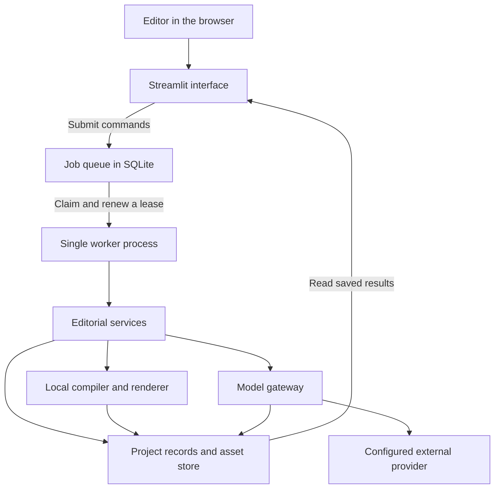
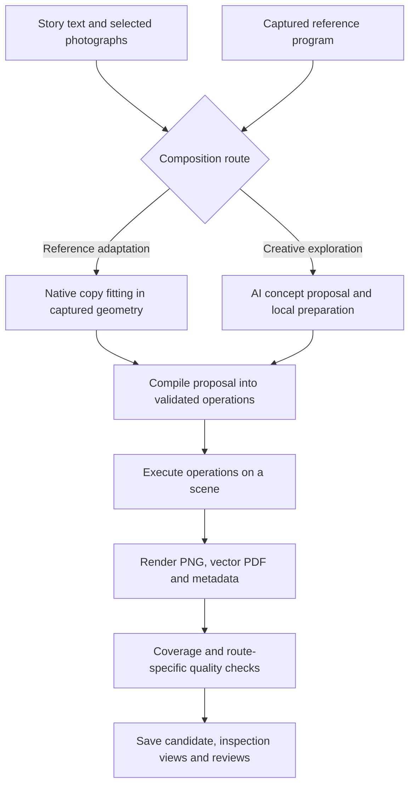
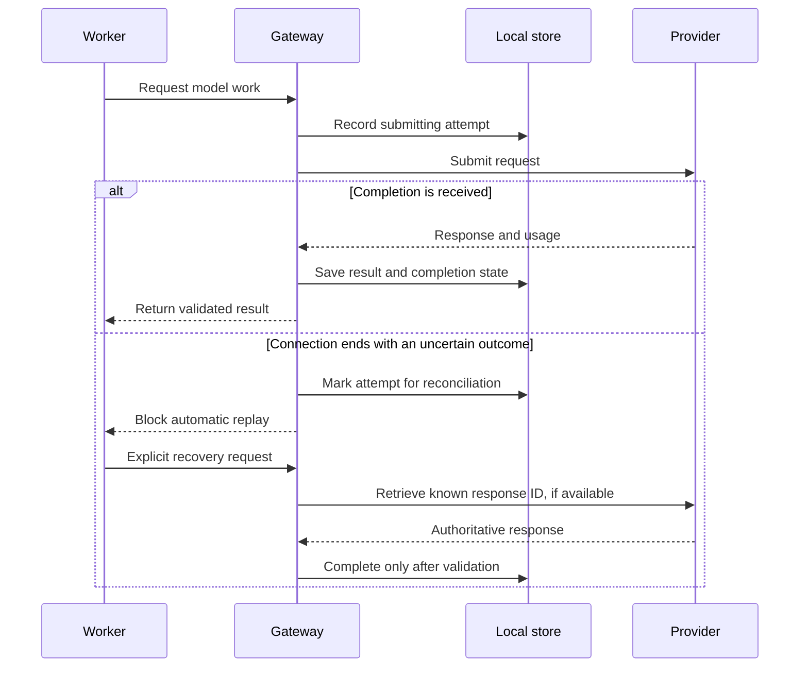

# Technical architecture

Autonomous Atelier is a local Python application with a browser interface and a separate worker process. The interface records requests for work. The worker performs the work and saves the results. Both use one local store, so closing a browser tab does not remove the queued job or its saved evidence.

The [domain architecture](architecture_domain.md) explains the editorial concepts. This guide explains how the code implements them.

## Runtime structure

The interface lives in [app.py](app.py), [editorial_studio/app.py](editorial_studio/app.py) and [ui/](editorial_studio/ui/). It opens the store for reading and submits typed commands through `Queue.submit`. That queue method has its own database write connection. Domain work runs in [worker.py](editorial_studio/worker.py), outside Streamlit reruns.

The worker holds a process lock and claims one queued job at a time. A **lease** is a temporary reservation: the job belongs to that worker until a deadline. Heartbeats renew the deadline while work continues. A saved step lets a restarted job reuse committed output. Recovery of an uncertain external call has an additional boundary, described below.

## Main code areas

| Area | Responsibility |
| --- | --- |
| [contracts/](editorial_studio/contracts/) | Pydantic data models, generated JSON schemas, operation definitions and validation rules. |
| [core/](editorial_studio/core/) | SQLite records, immutable file assets, commands, leases and saved job steps. |
| [content/](editorial_studio/content/) | Original text revisions, derived text and explicit source-character ranges. |
| [photos/](editorial_studio/photos/) and [segmentation/](editorial_studio/segmentation/) | Story ingestion, image diagnostics, photo maps, subject cutouts and alpha-edge checks. |
| [art_direction/](editorial_studio/art_direction/) and [design_system/](editorial_studio/design_system/) | Editorial identity, fonts, colours, spacing, tokens and reviewable identity packages. |
| [reference_studio/](editorial_studio/reference_studio/) | Authored references, captured composition programs, fitting, rendered admission and issue-wide selection. |
| [creative/](editorial_studio/creative/) and [spatial/](editorial_studio/spatial/) | Concept proposals, layout planning, compilation, critics, candidate tournaments and issue assembly. |
| [canvas/](editorial_studio/canvas/) | Editable scene versions, operation execution, native typography, effects and rendering. |
| [artifacts/](editorial_studio/artifacts/) | Asset-gap workflows, contextual image generation, tracing and inspection assets. |
| [production/](editorial_studio/production/) | Snapshot-bound preflight and physical-page exports with bleed. |
| [llm/](editorial_studio/llm/) and [telemetry/](editorial_studio/telemetry/) | Provider access, structured responses, caching, recovery, redaction, usage and cost estimates. |

These are modules in one application. They communicate through function calls and validated models; there is no separate server for each row.

## Records and large files

[Store](editorial_studio/core/storage.py) keeps structured records in `data/projects/studio.sqlite3` by default. SQLite uses WAL mode so the viewer can read while the worker writes. The database contains general typed records, asset metadata, queued commands and committed job steps.

Images, PDFs and JSON snapshots are stored as files under `data/projects/<project_id>/blobs/<sha256>`. The SHA-256 content hash identifies the bytes. Writing uses a temporary file, file synchronisation, an atomic rename and directory synchronisation before registering the asset. Reads check project membership and the stored hash.

Records point to asset IDs rather than copying large images into every record. Scene versions, selected proofs, identity snapshots and evidence fingerprints bind later review or export to a particular saved result. A fingerprint is a digest of the relevant evidence; changing that evidence invalidates the expected fingerprint.

The worker reconciles storage at startup, reporting missing or corrupt assets and quarantining unmatched files. The database and blob files together form the studio's working data. Git excludes that data, `.runtime/` and credentials.

## From story inputs to a rendered spread

### Preserve text and picture bindings

The [provenance ledger](editorial_studio/content/ledger.py) stores original text revisions and explicit derivations. The [compiler](editorial_studio/creative/compiler.py) reconciles each text layer against a source range. A story can spread its title or body across several frames while accounting for every source character exactly once. Visual readability is checked separately from this accounting.

Photo assets retain source and credit information. A matching cutout must belong to the selected photograph. Project checks reject bindings to other projects' assets or story records. The reference workflow explicitly imports permitted reference evidence into the target project's asset store.

### Adapt a captured design

[programs.py](editorial_studio/reference_studio/programs.py) captures an authored proposal as a composition program. It replaces source copy and photograph bindings with input slots while preserving typography, frame geometry, layer relationships and style characteristics. Slots also record title line counts, crop fractions and face-visibility constraints.

[fitting.py](editorial_studio/reference_studio/fitting.py) allocates exact word ranges and measures them with the native typography engine. It bounds headline scaling, preserves the reading-size floor, prefers feasible paragraph boundaries and checks photographic compatibility. Cover programs use a separate front/back topology. Image-filled words can share one photographic plane when source resolution permits it.

[quality.py](editorial_studio/reference_studio/quality.py) checks the actual render. Temporary recolourings and isolated word masks reveal occlusion, missing words, collisions and contrast problems. Display-ink area, photo/type overlap and background measurements help detect loss of the captured composition's important relationships. These thresholds are engineering admission rules.

The [composition service](editorial_studio/reference_studio/service.py) retains candidates and rejection reasons. It can add one bounded backing field for reading contrast. If requested, an art director model selects among admitted renders and a reference-aware model critic reviews the selection. A run with no admitted candidate has no selected design or proof book.

Reference admission uses the candidate's rendered-quality result. Exploratory candidates use execution, artistic and fidelity critics with bounded repair attempts; their states and tournament selection follow that route's own rules. These mechanisms share a compiler and renderer but have different selection gates.

The renderer supports more advanced techniques than this fitter. Text on a path and individual-glyph transformations, for example, have rendering support but need dedicated fitting logic before adaptation through the reference-program route.

### Compile and render

The compiler translates proposals into the operation contracts in [operation_registry.py](editorial_studio/contracts/operation_registry.py). The [executor](editorial_studio/canvas/executor.py) checks operation parameters, layer and asset access, scene versions and supported capabilities before applying changes.

A spread is one 420 × 297 mm scene. Layout proposals use normalised regions; compilation resolves them into physical bounds. Text is shaped and measured through Pango/HarfBuzz, then drawn through Cairo. Advanced typography adds outlines, path placement and irregular flow. The renderer uses the same scene and saved typography for raster previews and vector PDFs, and records text layouts and metadata for inspection.

## Assemble and export an issue

[creative/issue.py](editorial_studio/creative/issue.py) plans six story slots and maps them to twelve physical pages. One story is assigned to the cover scene and five to interior spreads. The cover scene represents back page 12 on the left and front page 1 on the right; the interior pairs are 2/3 through 10/11.

For reference-based issues, the builder fits candidates for each page role, then [selects a sequence jointly](editorial_studio/reference_studio/issue_selection.py). Selection favours family variety, avoids adjacent repeats and retains model preferences where compatible. It saves selected program IDs and embeds their composition mandates in the issue plan. Assembly reuses admitted scene snapshots, preserving their geometry and image scale.

Issue revisions retain unchanged scenes. A non-regenerating recheck of a reference scene validates it without forcing it through the exploratory layout preparer. Reader PDF generation splits the continuous scenes into physical pages; a printer-sheet mapping is recorded separately.

[Production export](editorial_studio/production/service.py) is a separate operation bound to the issue's evidence fingerprint. It checks native image sampling, source coverage, fold and bleed behaviour, embedded fonts and PDF-to-scene agreement. Hard errors block the production PDF. The current [production configuration](config/production.yaml) uses A4 pages, 3 mm bleed and a 300 native-PPI image requirement. Enlarged images retain their original sampling lineage. Outputs are RGB proofs, without PDF/X or printer-specific certification.

## Model calls and uncertain outcomes

All provider-backed text, vision and image-generation work passes through [Gateway](editorial_studio/llm/gateway.py). Structured model responses must satisfy their declared schemas and Pydantic validators before services use them. Input images must match project-scoped stored assets.

The gateway hashes the provider namespace, project, request content and prompt/schema versions to identify reusable work. Completed results can be reused after validation. Pending or ambiguous attempts require reconciliation before another submission of the same work. It stores redacted request/response payloads, visible output, attempts, usage, latency and versioned cost estimates.

A network timeout does not establish that the provider did nothing. If no retrievable response ID exists, manual reconciliation is needed. On worker startup, interrupted submitting attempts are also marked ambiguous. An external request and a local database transaction remain separate actions.

## Configuration and extension points

[config.yaml](config.yaml) selects models, timeouts, lease settings and feature flags. Environment variables override credentials loaded from the ignored `.env` file. Native rendering, fonts, segmentation, photo handling and production policy have separate files in [config/](config/). Pricing is versioned configuration, so recorded costs are estimates tied to a particular table.

New authored designs enter through the reference catalog and atlas, then use the capture and fitting path. New rendering operations require coordinated contract, executor, renderer and capability support. Segmentation uses a backend interface, and provider transport is isolated behind the gateway's provider interface. Automatic reference ingestion and automatic skill generation are disabled.

## Local environment

The [setup and run guide](setupandrun.md) provides the installation sequence, launch commands, first-use steps and troubleshooting.

Use an activated virtual environment. Python dependency metadata is in [pyproject.toml](pyproject.toml) and [uv.lock](uv.lock); the lock targets Linux x86_64. Native prerequisites and tested library hashes are recorded in [render-environment.yaml](config/render-environment.yaml) and [render-native-lock.yaml](config/render-native-lock.yaml).

Cairo, Pango, HarfBuzz, fontTools and PyMuPDF support rendering and inspection. OpenCV supports image processing; MobileSAM supplies subject segmentation; Potrace supports raster-to-vector tracing. Font files, checkpoint files and other local assets must match their configuration hashes. Asset installers and verification commands live in [scripts/](scripts/).

The repository contains source and configuration, rather than a complete studio database or a fresh-machine installer. A new installation needs Python and native dependencies, configured local assets and storage initialisation. An authored reference library must be restored with its project data or built through authoring workflows. The [README](README.md#run-locally) gives launch commands for the prepared environment.

Prepare a new environment in this order:

1. Provision the native libraries and Python dependencies described by the environment specification and dependency lock. The native specification records the tested workstation, so verify compatibility on the target machine.
2. Install matching local assets. [install_fonts.py](scripts/install_fonts.py) copies the pinned base fonts from matching system fonts. [install_flagship_assets.py](scripts/install_flagship_assets.py) downloads pinned sample assets, and [install_m10a_font.py](scripts/install_m10a_font.py) installs the extra italic display face. These scripts cover named asset sets, not every dependency.
3. Supply the checkpoint and tool files required by enabled workflows: [segmentation.yaml](config/segmentation.yaml) specifies MobileSAM, [photo_pipeline.yaml](config/photo_pipeline.yaml) specifies FSRCNN, and [artifacts.yaml](config/artifacts.yaml) specifies Potrace. Match each configured path and hash.
4. Set credentials, initialise storage and launch the interface and worker using the README commands. Add stories and create an identity, then author or restore references before using reference-based composition.

Source tests run with `python -m pytest -q`. The optional sample-asset installers do not generate an authored library or restore an issue database.

## Verification boundaries

[tests/](tests/) covers contracts, source tracking, rendering, fitting, provider recovery, job ownership, UI command submission, issue assembly and production checks. Generated JSON schemas are checked against their defining models. Saved-proof verifiers check actual snapshots, source reconstruction, font embedding, native inspection crops and export agreement.

Those checks establish specific mechanical properties. Visual review still matters for hierarchy, photographic integration and deliberate space. Human approval is recorded separately and bound to reviewed evidence. Native raster sampling can differ between preview and PDF renderers; such discrepancies remain explicit in verification reports rather than being described as exact visual equivalence.
